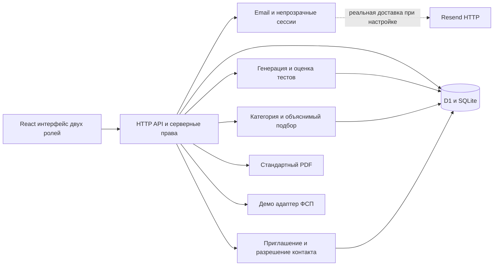

# Архитектура ФСП Карьера

Приложение реализовано как модульный монолит. Один Worker обслуживает React-интерфейс и HTTP API; база D1 хранит пользователей, доказательства компетенций, исходные подборки и разрешения на контакты. Доменные функции не зависят от базы и могут проверяться отдельно. Проверка тестов и подбор выполняются локально на CPU по заданным эталонам и правилам.

Версия приложения — **1.0.2**; исходный тег пакета — **v1.0.3-hackathon**.

## Модули

| Каталог | Ответственность |
| --- | --- |
| `components/career/` | Кабинеты кандидата и работодателя, анкета и её история, тест, формы, поиск, приглашения и статусы откликов |
| `app/api/[...path]/route.ts` | Маршрутизация API и единый формат ошибок |
| `lib/server/security.ts`, `auth.ts` | Валидация, лимиты, пароли, сессии, подтверждение email |
| `lib/server/profiles.ts`, `profile-actions.ts` | Согласия, приватный и публичный DTO, изменение разрешённых полей |
| `lib/server/questionnaires.ts` | Обязательная отрасль и категория, неизменяемая история, привязка последней собственной анкеты к тесту |
| `lib/server/exams.ts` | Владелец попытки, время, история, сохранение результата |
| `lib/server/hiring.ts` | Потребности, снимок исходного ранжирования, приглашения, вакансии и отклики |
| `lib/server/pdf.ts` | PDF с кириллицей и теми же разрешениями на контакты |
| `lib/domain/` | Параметрический банк, рубрика и версия формулы подбора |
| `db/schema.ts`, `drizzle/` | Описание таблиц и воспроизводимые миграции |
| `tests/`, `scripts/validate-domain.ts` | Доменные, API, приватностные и нагрузочные проверки |

## Данные и состояние

| Таблица | Содержимое и ключевой инвариант |
| --- | --- |
| `users` | Email, роль, солёный парольный хэш, подтверждение адреса, согласие на обработку |
| `profiles` | Профиль, заявленные роли и софт-скиллы, отдельно заявленные и продемонстрированные навыки, подтверждённый грейд, согласие на публикацию, история ФСП |
| `sessions` | Только хэш случайного токена и срок семь дней |
| `verification_tokens` | Хэш одноразового токена, срок 24 часа; plaintext только для собственного демо-ящика |
| `auth_attempts` | Лимиты попыток по хэшированному ключу без хранения исходного IP |
| `questionnaire_attempts` | Собственная история отрасли, специализации и самооценки; новые строки дополняют историю |
| `test_attempts` | Приватный вариант с эталоном, владелец, срок, ссылка на анкету, неизменяемый результат отправленной попытки |
| `demands` | Потребность компании, требования и первый сохранённый снимок рекомендаций |
| `invitations` | Пригласившая компания, кандидат, зарплата, pending/accepted/declined |
| `vacancies`, `applications` | Публикация потребности, адресное согласие контакта через отклик и sent/viewed/accepted/declined с датой обновления |
| `demo_pairs`, `seed_state` | Изолированные демо-пары браузера и версия идемпотентного синтетического набора |

Одна активная попытка на пользователя обеспечивается частичным уникальным индексом. Перед новой попыткой сервер закрывает истёкшую. Отправка обновляет только ещё не завершённую попытку; результат и подтверждённый профиль записываются атомарным batch D1. Другой пользователь не может отправить чужую попытку. База хранит прежнюю подтверждённую категорию при провале.

Перед тестом сервер сверяет последнюю собственную анкету с запрошенной категорией. Создание анкеты и обновление контекста профиля выполняются batch D1; подтверждённая категория от самооценки не меняется. Старые попытки могут иметь пустую ссылку на анкету и остаются читаемыми. Миграция 0002 дополняет прежнюю схему; upgrade-тест сохраняет старые записи и снимок, fresh-тест проверяет новую установку и внешние ключи.

## Подбор и исходный снимок

Специализация и подтверждённый грейд образуют категорию. Все обязательные навыки должны быть продемонстрированы тестом. Внутри категории используется версия формулы `fsp-evidence-match-1.0.0`; объяснения и компоненты балла сохраняются вместе с исходной выдачей. Последующие фильтры работают поверх сохранённого набора и не перезаписывают его. Повторный `match` возвращает тот же первый снимок.

Каталог без потребности использует отдельную версию `fsp-category-evidence-1.0.0`: группировка по подтверждённой категории, затем 95 баллов за результат теста и до 5 за релевантные достижения ФСП, стабильный ID при равенстве. Роли, софт-скиллы, стаж и самооценка не повышают балл.

Исходный снимок не отменяет текущую приватность. При чтении старого снимка заново скрываются контактоподобные строки, включая Telegram-ссылки и имена; историческое содержимое не переписывается. Перед каждым чтением сервер исключает профили, отозвавшие публикацию или обработку. После отзыва публикации профиль с принятым приглашением остаётся доступен этой компании в существующем разговоре только при действующем согласии на обработку. Отзыв обработки закрывает работодателям карточку и PDF, а также скрывает контакты в принятых приглашениях. Профиль не возвращается в витрину или старую подборку. Ранее раскрытые браузеру сведения невозможно технически «отозвать» у получателя; сервер прекращает новые публикации.

## Контакты и права

Контакт открывается по наличию принятого приглашения или самостоятельного отклика именно для пары `employerId + candidateId`. Принятие одной компании не создаёт глобального публичного разрешения. Авторизация повторяется на JSON и PDF. Публичные DTO собираются из разрешённых полей, а не копированием строки базы; email и телефон не участвуют в ранжировании. В свободном тексте скрываются типичные email, телефонные строки, Telegram-ссылки и имена до разрешения контакта. Это защита от случайного переноса контакта, а не полная автоматическая классификация персональных данных.

Каждая серверная операция проверяет сессию, подтверждение email, роль и владельца. PATCH принимает только разрешённые поля: пользователь не может присвоить себе грейд, тестовый балл или подтверждение ФСП. Смена специализации уже подтверждённого профиля возможна через тест и политику интервала, а не изменением текстового поля.

## Вакансии и статусы откликов

Отклик создаётся в статусе `sent` и даёт адресное разрешение контакта работодателю этой вакансии при действующем согласии на обработку. Обе стороны видят только собственные отклики. Работодатель-владелец может отметить `viewed`, `accepted` или `declined`; кандидат читает состояние. Принятое или отклонённое решение окончательно, повтор такого же состояния идемпотентен, повторная отправка отклика не сбрасывает статус. Контакты читаются через отдельную проверку карточки, а не дублируются в списке откликов.

## Защита приложения

Сессии содержат 32 случайных байта; в D1 хранится SHA-256 токена. Cookie HttpOnly, SameSite=Lax и Secure на HTTPS. PBKDF2-SHA256 использует отдельную случайную соль и 100 000 итераций — native WebCrypto Workers ограничивает этот параметр. Для промышленной версии предусмотрены внешний OIDC или более затратный KDF; MVP не заявляется промышленной IAM-системой.

Изменения принимают application/json и проверяют Origin при его наличии. Поток тела ограничен 64 КиБ. SQL-запросы параметризованы; поля UPDATE определяются серверным списком. Лимиты действуют для регистрации, входа, повторного письма, демо и новых тестов. API не возвращает SQL, stack trace, токены или секреты. Rate limit в D1 подходит демонстрации; распределённая защита от злоупотреблений и аудит администратора относятся к промышленному развитию.

## Email и будущая ФСП

Серверный почтовый адаптер использует Resend HTTP при настроенных секретах. В демо регистрация всё равно создаёт ожидающую подтверждения сессию, а токен выдаёт только владельцу его демо-ящик. Признак `demoMode` и почтовый режим доступны через метаданные. Текущий стенд работает локально; роли кандидата и работодателя проверяются сервером приложения.

Вместо реального недоступного API ФСП реализован адаптер `mock-fsp` с шестью фиксированными ID и кодами. Ответы содержат источник, дату, дисциплину, результат, место и признак команды. Будущий адаптер должен получать ID от доверенного OIDC/Keycloak, подтверждать связь аккаунта с участником и проверять подпись/доступ к реестру. Нельзя перенести демо-коды в реальную верификацию. Сбой реестра не блокирует профиль без ФСП и не превращает непроверенные достижения в подтверждённые.

## Размещение

Сейчас Worker работает локально и в Docker через Wrangler/Miniflare, D1 — постоянная SQLite-база. Docker не является отдельной Node/Express-реализацией и не меняет алгоритм. Миграции применяются до обслуживания запросов, синтетические начальные данные — отдельным идемпотентным действием. Облачный стенд ещё не опубликован. Будущие варианты — VM в Яндекс Cloud с проверкой runtime за HTTPS-прокси либо native Worker с настоящей D1; подробности в [руководстве по размещению](deployment-options.md).

Для публичного пилота нужны HTTPS, настроенная настоящая почта, резервное копирование D1, мониторинг ошибок, проверка работодателей и работа с запросами пользователей на удаление данных. Это следующий этап внедрения; демонстрационный стенд проверяет заявленный сквозной сценарий.
